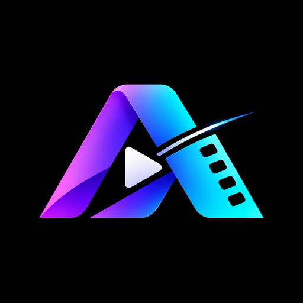

<p align="center">
  
</p>

<h1 align="center">ArAr Cut</h1>

<p align="center">
  <b>Open-source, local-first pro mobile video editor for Android — powered by Rust, wgpu, FFmpeg 8.1, and Jetpack Compose.</b><br>
  No accounts, no cloud lock-in, no watermarks, no subscriptions.
</p>

<p align="center">
  <a href="https://github.com/gudangjoker/ArAr-Cut/releases/latest">
    
  </a>
  <a href="https://apps.obtainium.imranr.dev/redirect?r=obtainium://add/https://github.com/gudangjoker/ArAr-Cut">
    
  </a>
</p>

<p align="center">
  <a href="https://github.com/gudangjoker/ArAr-Cut/releases/latest"></a>
  
  
  
  
  
</p>

<p align="center">
  <a href="#highlights">Highlights</a> ·
  <a href="#pro-engine-features">Pro Engine</a> ·
  <a href="#installation--verification">Installation</a> ·
  <a href="#architecture">Architecture</a> ·
  <a href="#building">Building</a> ·
  <a href="#platform-roadmap">Roadmap</a> ·
  <a href="#license--credits">License</a>
</p>

---

## Highlights

ArAr Cut combines the fast mobile timeline UX and 201-shader GPU compositor of [CapCraft / Concat](https://github.com/artcraft-android/capcraft-android) with pure-Rust broadcast audio DSP, cinema color science, real-time video scopes, speaker diarization, and desktop NLE interchange from [FilmCraft](https://github.com/artcraft-android/filmcraft-android).

- **100% On-Device & Offline** — All decoding, GPU compositing, audio mastering, color grading, captioning, and export run locally on your device. Zero telemetry, zero cloud uploads.
- **Hardware-Accelerated Engine** — Rust native core (`libararcut_android.so`) with `wgpu` Vulkan GPU rendering (201 WGSL shaders) and FFmpeg 8.1 + Android `AMediaCodec` hardware decode/encode.
- **Adaptive Portrait & Landscape UI** — Full vertical phone workflow plus an automatic two-pane **Sideways Landscape** studio layout on wide screens, tablets, and foldables (`≥ 600 dp`).
- **Android 15/16 Ready** — 16 KB ELF page alignment, `targetSdk 36`, foreground export timeout handling, and adaptive/monochrome launcher icons.

---

## Feature Matrix

### Core Video & Timeline Editing
| Category | Capabilities |
|---|---|
| **Timeline** | Multi-track timeline (video, overlays, audio, text, stickers, effects), trim, split, ripple/move, duplicate, replace, multi-select, pinch-to-zoom, unlimited undo/redo, autosave |
| **Transform & Motion** | Keyframes, speed ramps & curves, freeze frame, reverse clip, crop, auto-reframe, masks, chroma key, blend modes, motion blur, stabilization |
| **Looks & VFX** | 80+ GPU filters, HSL/curves/color wheels adjustments, video & body effects, animated transitions, relight & retouch |
| **Text & Graphics** | Title templates, fonts, word art, bubbles, text animations, stickers, shapes, freehand drawing, collage & cover editor |
| **Captions & Speech** | On-device speech-to-text auto captions (Whisper / sherpa-onnx), SRT import, caption templates, voiceover recording, text-to-speech, voice isolation & noise reduction |
| **Export** | Hardware MP4 export from 480p up to **4K** (24–60 fps) with bitrate/size estimator, animated GIF, and high-res still photo |

### Pro Engine Features
Powered by vendored pure-Rust modules from FilmCraft:

- **Pro Audio DSP (`filmcraft-audio-dsp`)**
  - **EBU R128 / ITU-R BS.1770-4 Loudness Meter** — Integrated LUFS, Short-Term Max, Loudness Range (LU), and 4× oversampled True Peak (dBTP).
  - **6 Mastering & Restoration Chains** — *Social Punch (-14 LUFS)*, *Broadcast Voice (-16 LUFS)*, *Cinema Master (-23 LUFS)*, *Dialogue Cleanup*, *De-Ess & Warmth*, and *De-Reverb / Room Rescue*, with selectable LUFS targets and one-tap non-destructive Revert.
  - **GCC-PHAT Sample-Accurate Audio Sync** — Automatically aligns overlay/secondary audio clips to the main track with confidence scoring.
- **Cinema Color Science (`filmcraft-color`)**
  - **12 Camera Log → Rec.709 GPU LUTs** — Sony S-Log3, S-Log2, ARRI LogC3, LogC4, RED Log3G10, Canon Log 2 & 3, Panasonic V-Log, Fujifilm F-Log & F-Log2, Apple Log, and DJI D-Log.
  - Bakes a 33³ `.cube` 3D LUT with BT.2390 highlight roll-off and ACES gamut compression directly into the `wgpu` GPU shader pipeline for 60 fps playback.
- **Live Video Scopes HUD (`filmcraft-scopes`)**
  - Floating real-time overlay over the preview monitor: **RGB Waveform**, **Luma Waveform (Y)**, **RGB Parade**, **YUV Vectorscope**, and **Histogram**.
- **On-Device Speaker Diarization**
  - Classical MFCC + agglomerative voice clustering (zero neural model downloads) that automatically labels caption clips (`Speaker 1:`, `Speaker 2:`, …) in a single undo step.
- **Desktop NLE Interchange Export**
  - Continue editing on desktop NLEs with one-tap timeline export to:
    - **Premiere Pro / DaVinci Resolve XML** (`xmeml` v5 `.xml`)
    - **Final Cut Pro / Resolve** (`FCPXML` v1.11 `.fcpxml`)
    - **OpenTimelineIO** (`.otio`)
    - **CMX 3600 EDL** (`.edl`)

---

## Installation & Verification

1. Download **`ararcut-android-1.0.0.apk`** (arm64-v8a) from the [GitHub Releases](https://github.com/gudangjoker/ArAr-Cut/releases/latest) page.
2. Optionally verify the file checksum against `ararcut-android-1.0.0.apk.sha256` and confirm the APK signing certificate:

```text
Package ID:  com.ararcut.app
Min Android: Android 10 (API 29)
ABI:         arm64-v8a
Cert SHA-256: 34:00:68:48:30:A6:DB:D3:78:B0:2B:9E:08:70:48:B5:2E:98:1F:53:08:53:8B:6F:30:A1:42:7D:DF:9B:BC:FB
```

3. You can also track automatic updates directly via **[Obtainium](https://github.com/ImranR98/Obtainium)** using this repository URL.

---

## Architecture

```text
src/
├── crates/
│   ├── ararcut-android/       # UniFFI bridge + Pro Audio/Color/Diarize/NLE + Jetpack Compose Android app
│   ├── concat-core/           # Core timeline math & types
│   ├── concat-project/        # Project document model, commands & undo history
│   ├── concat-media/          # FFmpeg 8.1 decode & AMediaCodec integration
│   ├── concat-render/         # wgpu Vulkan compositor + 201 WGSL shaders
│   ├── concat-export/         # Hardware-accelerated muxing & encoding
│   ├── concat-effects/        # Effect, filter, LUT & transition catalog
│   ├── concat-text/           # Typography, captions & layout engine
│   ├── concat-speech/         # On-device Whisper / sherpa-onnx speech & TTS
│   ├── concat-vision/         # ONNX Runtime background removal & tracking
│   ├── concat-host/           # Session orchestration, playback & caching
│   ├── filmcraft-audio-dsp/   # EBU R128, 30+ DSP processors, GCC-PHAT sync
│   ├── filmcraft-color/       # Camera Log curves, ACES gamut, BT.2390, 3D LUT baker
│   └── filmcraft-scopes/      # Waveform, Parade, Vectorscope & Histogram rasterizers
└── scripts/                   # Reproducible FFmpeg & sherpa-onnx mobile build scripts
```

---

## Building

### GitHub Actions (Recommended)
All official builds and CI checks run reproducibly via GitHub Actions:
- **Unit Tests & Rust Check**: [`.github/workflows/ci.yml`](.github/workflows/ci.yml) runs on every push/PR to `main`.
- **Android APK Build**: [`.github/workflows/release.yml`](.github/workflows/release.yml) builds `arm64-v8a` APKs on `v*` tags (signed via repository secrets `ARARCUT_KEYSTORE_BASE64`, `ARARCUT_KEYSTORE_PASSWORD`, `ARARCUT_KEY_ALIAS`, `ARARCUT_KEY_PASSWORD`) or manual dry-run (`Actions › Release › Run workflow`).

### Local CLI Build
<details>
  <summary>Requirements & commands</summary>

  - Linux or macOS (WSL on Windows), ≥ 10 GB free disk space
  - `rustup` (toolchain pinned in `src/rust-toolchain.toml`) + `rustup target add aarch64-linux-android`
  - `cargo-ndk` `4.1.2` (`cargo install cargo-ndk --version 4.1.2 --locked`)
  - Android SDK (API 37) + NDK `29.0.14206865`, JDK 17–21, `cmake`, `make`, `clang` / `libclang-dev`, `curl`

  ```bash
  cd src
  scripts/ffmpeg-mobile.sh aarch64-linux-android
  scripts/sherpa-mobile.sh aarch64-linux-android
  eval "$(scripts/mobile-env.sh aarch64-linux-android)"
  cd crates/ararcut-android/android
  ./gradlew assembleRelease -Pararcut.abis=arm64-v8a
  ```
</details>

---

## Platform Roadmap

- **Android (`arm64-v8a`)**: Stable release (`v1.0.0`).
- **macOS (Apple Silicon & Intel)**: Planned. The entire Rust engine (`concat-*` + `filmcraft-*`) already supports macOS natively (Metal via `wgpu`, VideoToolbox via FFmpeg, CoreML via ONNX Runtime, and CoreAudio). Future work adds a native SwiftUI shell via UniFFI Swift bindings (or Slint desktop UI) built via GitHub Actions `macos` runners. In the meantime, use **Export to Desktop NLE** (`.fcpxml`, `.xml`, `.otio`, `.edl`) to round-trip projects directly into Final Cut Pro, DaVinci Resolve, or Premiere Pro on macOS.

---

## License & Credits

- **ArAr Cut** is free and open-source software licensed under **[AGPL-3.0-or-later](LICENSE)**.
- Built on **[CapCraft for Android](https://github.com/artcraft-android/capcraft-android)** and **[Concat](https://github.com/jub0t/concat)** (`AGPL-3.0-or-later`).
- Includes pure-Rust audio DSP, color science, video scopes, and diarization algorithms from **[FilmCraft](https://github.com/artcraft-android/filmcraft-android)** (`MIT OR Apache-2.0`).
- Full third-party attributions and licenses are listed in [NOTICE](NOTICE) and [THIRD_PARTY_NOTICES.md](THIRD_PARTY_NOTICES.md).
- ArAr Cut is an independent open-source project and is not affiliated with or endorsed by ByteDance, CapCut, Apple, or Adobe.
